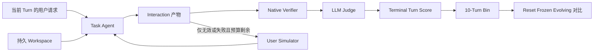
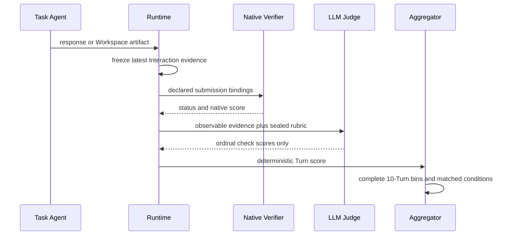

# L2 Demo V3：从原生 Benchmark 到可评测的持续学习任务流

> [!note] 学完后你应该能做到
>
> - 用自己的话解释 L2 的 `Stream → Turn → Interaction → verifier → Judge → bin` 数据与评分链路。
> - 分清“原生 Benchmark task”“L2 确定性派生 Turn”和“运行时实验结果”，不把 50 Turns 误写成 50 个上游任务。
> - 看懂六条 Stream 的来源、数据 Schema、运行方式、打分依据和 V3 构造规则。
> - 判断一个新任务能否加入已有 Stream，以及应暴露给用户、Agent、learner 和 evaluator 的内容。

## 0. 版本、证据与结论边界

| 项目 | 本文边界 |
|---|---|
| L2 数据合同 | `l2_taskstream/1.0`，`l2_evolution_aggregation/1.0` |
| 本地项目基线 | `ce66c1c57d62b85e82bae25bf22fc93d0895598c` 之上的未提交 V3 工作树；最终提交前应重新绑定 commit |
| V3 数据规模 | 6 Streams / 290 Turns |
| τ² / Telecom | `a2c024725189473d2d7cea3a5cfdbcc67478e41f` |
| SkillLearnBench | `a0da045a8bf64b8a8ff20730c4d6ef10dc4e2c5b` |
| SkillsBench | `9a1f4dd5f7659f75707435da3ce854b6e48321d1` |
| AIRS-Bench | `18e4f1d501069cf7d7e2740d81c2ca748c56a6a1` |
| MLGym | `9d40c1b5035202018cd7091fb4e83a9c68b377c0` |
| SRA-Bench / SR-Agents | `277fd8d2bbd7d3b81a5cf4ffa6e87e18c7906e4f` |
| 当前已验证 | 选择清单生成、290-Turn Schema、Prompt 绑定、可见性、Workspace transition、生成树完整性，以及 prepared verifier environment 下 700/700 个 package-local native fixtures |
| 最终交付门槛 | 生成 V3 ZIP 后做 fresh-unzip、独立校验与 SHA-256 检查；ZIP 的准确状态与 hash 记录在 package 外部的 acceptance record/sidecar，避免在 ZIP 内形成自引用 hash |
| 尚未证明 | 任何模型的 V3 learning curve、自进化收益、统计显著性，或共享 Runtime 的生产兼容性 |

论文入口：[$\tau^2$-Bench](https://arxiv.org/abs/2506.07982)、[SkillLearnBench](https://arxiv.org/abs/2604.20087)、[SkillsBench](https://arxiv.org/abs/2602.12670)、[AIRS-Bench](https://arxiv.org/abs/2602.06855)、[MLGym](https://arxiv.org/abs/2502.14499)、[SRA-Bench](https://arxiv.org/abs/2604.24594)。这些论文未在本轮命中用户 Zotero，本文对论文级表述保留在线来源边界；实现结论优先锚定 pinned checkout。

## 1. 为什么 L2 不是“把单题复制 50 次”

单轮 Benchmark 回答的是：“模型能否完成这道题？”L2 要回答的是：“同一个 SUT 在连续相关任务中，能否利用前序经验，在持久 Workspace 和受控更新条件下变得更可靠？”

因此，L2 数据必须同时具备四个性质：

1. **任务本身可判定**：每个 Turn 保留原 Benchmark 的 deterministic verifier 或原生连续 metric。
2. **Turn 之间确实相关**：`capability_relation` 写明共享能力、父 Turn 和预期迁移，而不是只靠目录相邻。
3. **序列作用可分析**：`sequence_role` 区分首次建立能力、普通应用和周期 Probe。
4. **对照实验可匹配**：同一顺序分别运行 `reset`、`frozen`、`evolving`，才能把 Workspace 延续与 SUT 更新的作用拆开。

> [!warning] 两个常见偷换
>
> - “有 50 Turns”不等于“上游有 50 个独立 native tasks”。V3 有 157 个 native Turns 和 133 个明示 derived Turns。
> - “能算两个 bin”不等于“已经观察到 learning curve”。数据形状、Runtime 跑通和模型收益是三个不同证据层级。

## 2. 一屏心智模型

> [!note] 一句话模型
>
> L2 把同一能力族的完整任务按固定顺序放进一个持久 Stream；每个 Turn 最多尝试三次，先由原生 verifier 产出客观证据，再由统一 Judge 映射为 Turn score，最后用匹配的 Reset/Frozen/Evolving 运行结果按 10 Turns 聚合。



### 2.1 核心对象

| 对象 | 负责什么 | 不负责什么 |
|---|---|---|
| Benchmark | 六条 Stream 的总索引、版本与公共聚合 Profile | 不替某个 Turn 决定答案 |
| Stream | 固定顺序、共享能力关系、一个持久 Workspace | 不与其他 Stream 共享可写状态 |
| Turn | 一个完整、可独立评分的用户任务 | 不是研究流程中的一个子阶段 |
| Interaction | Agent 的一次尝试及其冻结证据 | API transport retry 不算 Interaction |
| `sequence_role` | 标记 `learning/application/probe/replay/noise` 以便分析 | 不是 scorer，也不自动换 Prompt |
| native verifier | 检查执行结果、文件、状态或连续 metric | 不负责衡量跨 Turn 自进化 |
| LLM Judge | 按统一尺度解释 native evidence、合规和副作用 | 不可推翻 native failure，也不可自报总分 |
| aggregation | 取 terminal score，按完整 10-Turn bin 和匹配 condition 统计 | 不从单条 evolving 曲线直接宣称因果收益 |

### 2.2 Agent 到底能看到什么

| 内容 | Task Agent | learner / SUT 更新器 | native verifier / Judge |
|---|---:|---:|---:|
| 当前 `agent_input` 与当前 Turn public assets | 是 | 可按 Runtime 合同投影 | 是 |
| 当前及前序 Workspace 可见状态 | 按 condition | 按 condition | 是 |
| `sequence_role`、来源 ID、选择清单 | 否 | 不应作为答题提示 | 是 |
| hidden labels、gold、tests、private diagnostics | 否 | 否 | 是 |
| 未来 Turn 的输入 | 否 | 否 | 到该 Turn 初始化时才可用 |

用户需要输入的是**当前完整任务及允许的 public assets/tools**；用户或 SUT 应学习的是可迁移的过程知识，例如诊断顺序、数据清洗策略、D3 artifact workflow、失败模式和工具使用约束。它不应“学习”隐藏标签、gold 文件、未来任务或 Probe 位置。

## 3. V3 数据总览

| Stream | Turns | 完整 bins | native | derived | 当前序列角色 |
|---|---:|---:|---:|---:|---|
| SRA BigCodeBench pandas/viz | 100 | 10 | 100 | 0 | 1 learning + 89 application + 10 probe |
| τ² Telecom mobile data | 50 | 5 | 50 | 0 | 1 + 44 + 5 |
| SkillLearn stock visualization | 50 | 5 | 5 | 45 | 1 + 44 + 5 |
| SkillsBench data-to-d3 | 50 | 5 | 1 | 49 | 1 + 44 + 5 |
| AIRS SICK textual entailment | 20 | 2 | 0 | 20 | 1 + 17 + 2 |
| MLGym Titanic | 20 | 2 | 1 | 19 | 1 + 17 + 2 |
| **合计** | **290** | **29** | **157** | **133** | `replay/noise` 暂不使用 |

每条 50-Turn Stream 在 Turn 10/20/30/40/50 放置 Probe；20-Turn Stream 在 Turn 10/20 放置 Probe；SRA 延续 Turn 10…100。Probe 引用当前 bin 的前九个父 Turns，并写出具体 `expected_transfer`。

## 4. 六个来源 Benchmark 到底在测什么

### 4.1 τ² Telecom：真实客服中的协作式工具使用

**源码事实**：τ² 是客服 Agent simulation framework；一个 domain 提供 policy、agent tools、tasks，以及可选 user tools。原生任务的 `evaluation_criteria` 包含参考 `actions`、环境断言、沟通要求和 `reward_basis`。

**最重要的评分判断**：`evaluation_criteria.actions` 通常是一条参考解法，不是唯一强制轨迹。只有 `ACTION` 在 `reward_basis` 中时才直接要求动作匹配。V3 选择的 50 个 Telecom 任务全部是 `reward_basis=[ENV_ASSERTION]`，所以 native truth 是最终环境断言，不是“是否照抄 actions”。

**原生运行**：checkout 后用 `uv sync`，再以 `tau2 run --domain ...` 驱动真实半双工 Agent/User/Tool 对话。

**V3 映射**：从 pinned `telecom/tasks.json` 的 254 个同 purpose 候选中，按原始顺序选前 50 个。L2 Demo 用严格 JSON trajectory carrier 和 package-local replay adapter 重建相关状态、执行工具语义、检查最终 `ENV_ASSERTION`。这是对原生任务 scoring semantics 的适配，不是完整复刻 τ² live orchestrator、voice 或全 Telecom DB。

**Schema 摘要**：

```text
native task = ticket + initial_state + evaluation_criteria
evaluation_criteria = actions + env_assertions + reward_basis
L2 submission = assistant_message + ordered tool_calls
native result = terminal ENV_ASSERTION pass/fail
```

### 4.2 SkillLearnBench：从经验生成并复用 Agent Skills

**源码事实**：SkillLearnBench 面向生成 Agent skills 的 continual-learning 方法，共 20 tasks / 100 instances，并分别看 task success、skill quality 和 trajectory quality。`stock-data-visualization` 只有 5 个 native instances，不是 50 个。

**原生 Schema 与运行**：每个 instance 包含 `instruction.md`、`task.toml`、`environment/`、`tests/`、`solution/`。每个 trial 在 Docker 中执行 Agent，随后运行 `tests/test.sh`；pytest/Playwright 通过写 `reward.txt=1`，否则写 `0`。

**V3 映射**：

- Turns 1–5：五个 native siblings，覆盖 CSV、JSON、TSV、噪声额外股票文件和 request rephrasing。
- Turns 6–50：对五个父实例做 45 个唯一、确定性的 descriptor row rotation。
- 保持 50 个 stock entities、字段值、D3 v6 页面要求和完整 browser verifier 不变。

**判断边界**：row rotation 能检验 artifact workflow 对顺序扰动的稳定性，但不能替代 45 个语义独立的新任务。介绍或论文必须写成“5 native + 45 controlled variants”。

### 4.3 SkillsBench data-to-d3：Agent 是否会正确使用可复用 Skill

**源码事实**：SkillsBench 把 Skill 定义为模块化 instructions/scripts/resources，使用 BenchFlow native task package：`task.md`、`environment/skills/`、`oracle/solve.sh`、`verifier/test.sh`。`data-to-d3` 要求输出 D3 v6 单页应用、bubble chart、50-stock table 和联动交互；browser tests 最终给 binary reward。

**原生运行**：安装 BenchFlow CLI，先 `bench tasks check`，再用 oracle 和 sandbox 运行，最后再换成被测 Agent。

**V3 映射**：该严格 capability 在 pinned checkout 中只有一个 native task。Turn 1 保留 native CSV task；Turns 2–50 是 49 个唯一 `(CSV/JSON/TSV format, descriptor rotation)` 变体。D3 skill 在 Turn 1 写入 persistent Workspace，后续 Turn 复用。

> [!warning] 与 SkillLearnBench 的关系
>
> 两者的 stock fixture、oracle 和 tests 高度相近。保留两条 Stream 的理由是验证两个不同上游 adapter、Skill 注入方式和 provenance contract；不能把它们当作两类独立内容来夸大任务多样性。

### 4.4 AIRS SICK：端到端 AI Research Agent 任务

**源码事实**：AIRS-Bench 包含 20 个异构研究任务；每个 RAD task 由 `metadata.yaml`、`project_description.md`、`prepare.py`、`evaluate_prepare.py`、`evaluate.py` 和可选 `utils.py` 组成。SICK task 的输入是 `sentence_A/sentence_B`，输出 `label∈{0,1,2}`，原生 metric 为 Accuracy。

**原生评分**：AIRS leaderboard 用 worst、SOTA、optimal anchors 和非线性 $-\log_{10}(|s-s^{opt}|)$ 变换做跨任务归一化。对完整 SICK task，metadata 给出 SOTA `0.905`、estimated worst `0.1451284`、optimal `1.0`。

**V3 映射**：不能把 AIRS 的 20 个不同 modality/metric tasks 混成一条“同能力学习曲线”。因此 V3 将完整 4,906-row hidden SICK test pool 用固定 SHA-256 规则切成 20 个互斥且完备的 folds；每个 Turn 共享 train/validation、label space、artifact schema 和 raw Accuracy。

所有 20 Turns 都标成 derived，因为任何 fold 都不是 AIRS 发布的独立 native task。L2 的 Judge value 对这些 folds 使用 identity `[0,1]`，partial boundary 是该 fold 的 majority-class Accuracy，full boundary 是项目配置 `0.8`。这不是官方 AIRS nonlinear normalization；后者只作为完整 native task 的 provenance 保留。

### 4.5 MLGym Titanic：可迭代的机器学习研究环境

**源码事实**：MLGym 是面向 AI Research Agents 的 Gym-style framework，任务要求提出方案、处理数据、实现、训练、实验、分析并迭代。Titanic 的 task config 要求生成 `submission.csv(PassengerId, Survived)`，由 `CSVSubmissionTasks` 调用 evaluator 并解析 JSON Accuracy；上游 baseline 是 `0.76555`。

**原生运行**：安装 MLGym、配置 Docker/Podman 与模型环境变量，再以 `run.py --task_config_path ...` 启动任务。

**V3 映射**：pinned MLGym 只有一个 Titanic task。Turn 1 保留完整 418-row native hidden split；Turns 2–20 将同一 split 做确定性分层划分，每组包含 14 个 class-0 与 8 个 class-1 样本，组内按 PassengerId 排序。19 个 22-row cohorts 互斥且 union 恰好是完整 split，但 Turn 1 与这个 union 重叠。

partial boundary 是每个 cohort 的 majority-class Accuracy `14/22≈0.6364`；full boundary 保留 native baseline `0.76555`，因此 bands 始终有序。由于每个 derived cohort 只有 22 行，单 Turn Accuracy 方差仍然较大，V3 只能验证数据/评分接口和最小两-bin 形状，不能据此宣称稳定研究结论。

### 4.6 SRA BigCodeBench：检索并应用可执行能力

**源码事实**：SRA 把 skills 当作外部 capability corpus，完整过程是 retrieve → incorporate → apply。V3 保留现有 100 个 native BigCodeBench items，它们共享 pandas skill 和 Matplotlib/Seaborn visualization workflow，但各自保留原生 execution tests。

**V3 作用**：这是当前唯一有 100 个同筛选规则 native Turns 的长 Stream，可形成 10 个 bins。它是学习曲线 plumbing 的最强数据基础，但没有匹配的 Reset/Frozen/Evolving 模型运行结果时，仍不能声称观察到自进化。

## 5. L2 Task Schema：一条 Turn 里到底写什么

```text
task.json
├── identity: stream_id / turn_id / turn_index
├── source_basis: native or derived provenance
├── sequence_role
├── capability_relation
│   ├── capability_id
│   ├── parent_turn_ids
│   └── expected_transfer
├── agent_input: messages / public tools / public assets
├── workspace_transition: current-Turn initialization only
├── user_simulator: bounded post-failure retry
└── evaluation
    ├── submission_contract
    ├── native_verifier + private input bindings
    ├── Judge Prompt / routed rubrics
    ├── GT and expected effects
    └── latest-only success policy
```

### 5.1 native 与 derived 怎么写

| 情况 | `turn_origin` | `source_task_id` | `parent_source_task_ids` | 必须补充 |
|---|---|---|---|---|
| 一对一上游任务 | `source_task` | 原生 ID | 空 | revision、path、selector |
| 数据切片或格式变体 | `derived_evolution_turn` | `null` | 原生父 ID | deterministic transform、manifest、输入/输出 hash |

判断规则：如果上游作者不会把这条数据算作一个独立 task/instance，就不能因为 L2 给它建了一个 Turn 而改称 native。

### 5.2 `capability_relation` 怎么写

普通 application 默认引用前一个 Turn；每个 Probe 引用该 bin 之前的九个 Turns。`expected_transfer` 必须写“要迁移什么”，例如“复用 mobile-data diagnosis procedure 处理新的 composite root cause”，不能只写“这是一个 Probe”。

### 5.3 Workspace 与未来信息

一个 Stream 只有一个 persistent Workspace。每个 Turn 的 public inputs 先留在自己的 package `assets/`，到该 Turn 才通过 `workspace_transition` 复制到 `agent_workspace/episodes/E###/`。这同时满足：

- evolving/frozen 可继续使用前序 Workspace；
- reset 可从 frozen seed 加当前 transition 重建；
- future-Turn inputs 不会提前泄漏。

## 6. 评分链：为什么 native verifier 和 Judge 都需要



### 6.1 General profile

SRA、Telecom、SkillLearnBench、SkillsBench 使用 Judge Prompt V1。V3 复用同一通用 Prompt，因为它们都通过 deterministic native result 表达客观完成情况；domain surface 不需要复制 Prompt。当前 Demo checks 是：

| Check | Weight | 含义 |
|---|---:|---|
| `task_completion` | 0.60 | native evidence 是否证明任务完成 |
| `requirement_and_output_compliance` | 0.25 | carrier、格式和显式要求是否满足 |
| `evidence_and_side_effect_integrity` | 0.15 | 执行证据、路径、状态与副作用是否可信 |

这些权重和 `0.8` success threshold 是 Demo configuration，不是 L2 的普遍定律。

### 6.2 AutoResearch profile

AIRS、MLGym 使用 Judge Prompt V2，因为它需要额外注入 `metric_profile`、AutoResearch domain rubric 和 benchmark-specific rubric。两者仍共享一个 Prompt；只在 artifact schema、metric interpretation 和 reproducibility 上做小范围 rubric specialization：

- AIRS：一个 `label` column；derived folds 使用 identity-normalized Accuracy，不误用官方 task-level nonlinear transform。
- MLGym：`PassengerId/Survived` 两列、exact cohort coverage 和 PassengerId join。

AutoResearch 只有一个 `auto_research_overall` check：合法 artifact 达 full band 得 `1`，达到 partial band得 `0.5`，低于 partial 或 artifact 无效得 `0`。native continuous metric 是 Judge 的强制证据，不与 Judge 做 `0.7 + 0.3` 之类的并行加权。

### 6.3 Interaction 与 terminal score

每个 Turn 最多 3 个 Interactions；正式结果总是 `latest_interaction`，不是历史最好分。普通任务失败且尚有预算时可得到 bounded feedback；AutoResearch 的低分但 schema-valid artifact 已是有效完成，不因“分数低”自动重试。Verifier/Judge/control-plane error 是 evaluation error，不可偷偷记成 Agent 的 `0`。

## 7. 从 Turn score 到“自进化收益”

同一 Stream 和顺序需要三个匹配 condition：

| Condition | SUT persistent state | Workspace | 回答的问题 |
|---|---|---|---|
| Reset | 每 Turn 清空 | 从 seed + 当前 transition 重建 | 没有跨 Turn 延续时表现如何 |
| Frozen | 不允许更新 SUT | 跨 Turn 保留 | 仅 Workspace 延续带来什么 |
| Evolving | 允许声明的 SUT 更新 | 跨 Turn 保留 | Workspace + 自进化一起表现如何 |

每 10 Turns 的所有 terminal scores 取算术平均。主指标与诊断指标是：

$$
\Delta_{evo-reset}=\operatorname{mean}(Evolving)-\operatorname{mean}(Reset)
$$

$$
\Delta_{evo-frozen}=\operatorname{mean}(Evolving)-\operatorname{mean}(Frozen)
$$

`sequence_role` 可以另外报告 per-role mean，但 V1 尚未定义 forgetting、retention 或 transfer 的正式公式。一个 Probe 有自己的普通 Turn score；“它叫 Probe”本身不证明发生了 transfer。

## 8. 如何重建、检查和交付 V3

### 8.1 冻结选择并生成数据

```bash
python3 scripts/select_l2_v3_streams.py
python3 scripts/build_l2_contract_v1_pilot.py
```

第一条命令只更新项目拥有的 selection/migration indexes，不写 `third_party/src/*`。第二条命令生成自包含、可丢弃重建的 `l2_demo/contract_v1_pilot/` Runtime handoff tree。

### 8.2 校验合同与 native scoring

```bash
python3 docs/contracts/l2-v1/validate_contract.py
python3 scripts/validate_l2_contract_v1_pilot.py
L2_PILOT_VERIFIER_PYTHON=/home/alex_mercer/projects/research/self-evolving-benchmark/l2_demo/runtime/.venv/bin/python \
  python3 scripts/validate_l2_contract_v1_pilot.py --native-smoke
```

默认检查覆盖 290 Tasks 的 Schema、Prompt、生成树 hash、provenance、Workspace transition 和 private/public separation。`--native-smoke` 是另一个依赖更重的完整 gate，需要 prepared verifier Python、pandas、pytest、Playwright/Chromium 等 Runtime-owned dependencies；它运行 700 个 fixture cases：每个 General Turn 一绿一红；每个 AutoResearch Turn再覆盖 partial boundary、valid-low 和 wrong-carrier。不能用默认 validator 的 PASS 代替这个 gate。

### 8.3 生成独立 V3 ZIP

```bash
python3 scripts/package_l2_demo_v3.py
```

交付对象是 `release/L2_Demo_V3.zip`，不是 tracked migration-source `l2_demo/streams/`。Runtime/Baselines 应把 materialized `l2_taskstream/1.0` package 接入 `BUAA-Self-Evolving/tri-evobench`，并另行冻结 model、Sandbox、tools、资源预算与三种 condition 的 run configuration。

## 9. 现在这版能回答什么，不能回答什么

### 已经能回答

- 六条 Stream 的数据合同能否统一表达不同 carrier 与 native scoring。
- 290 Turns 是否都有可追溯来源、相关关系、sequence role、Prompt/Rubric 和 package-local verifier。
- 每条长流是否具备至少两个完整 10-Turn bins 的计算形状。
- hidden labels、tests 和 future inputs 是否与 Agent/learner 物理隔离。

### 仍不能回答

- 某个模型或方法是否真的 self-evolve。
- Evolving 优于 Reset/Frozen 是否稳定、显著、可复现。
- 受控 row rotation 是否足够代表真实任务分布变化。
- 22-row Titanic cohort 的单 Turn 差异是否来自学习而非抽样方差。
- package-local τ² replay adapter 与完整 live orchestrator 的行为是否完全等价。

> [!tip] 下一阶段判断顺序
>
> 先跑 package acceptance → 再做共享 Runtime integration smoke → 冻结三种 condition → 跑至少一个低成本 baseline → 检查 per-Turn failures 与数据泄漏 → 最后才汇报 learning curve。不要从“Validator 全绿”直接跳到“Benchmark 有效”。

## 10. 小练习

> [!question] 练习 1：概念重建
>
> 不看上文，用五句话重建从用户请求到一个 10-Turn bin 的完整数据与评分链。哪一步是 objective evidence，哪一步是语义映射？

<details>
<summary>参考答案</summary>

当前 Turn 的 public request/assets 经 Workspace transition 暴露给 Agent；Agent 在最多三次 Interaction 中产出声明的 carrier；Runtime 冻结 terminal/latest Interaction；native verifier 先检查执行结果并产生 objective evidence；LLM Judge 再按固定 Rubric 输出 ordinal checks，framework 聚合成 Turn score，十个相邻 terminal scores 得到一个 bin。native verifier 是 objective evidence，Judge 是统一语义与尺度映射。

</details>

> [!question] 练习 2：来源审计
>
> 如果有人把 SkillLearn Stream 写成“50 个 SkillLearnBench stock tasks”，你会查哪两个文件，并如何改写结论？

<details>
<summary>参考答案</summary>

先查 pinned upstream `README.md` 的 task inventory，确认 stock-data-visualization 只有 5 instances；再查 L2 Stream 的 `selection.json`，确认 5 native + 45 deterministic rotations。应改写为“50-Turn L2 Stream，由 5 个上游 native instances 和 45 个明示受控变体构成”。

</details>

> [!question] 练习 3：评分判断
>
> Telecom 某个 Agent 没有按 `evaluation_criteria.actions` 的顺序调用工具，但最终环境满足全部断言。应不应该因“轨迹不同”判失败？

<details>
<summary>参考答案</summary>

对当前 50 个任务不应该。它们的 `reward_basis` 只有 `ENV_ASSERTION`；actions 是参考轨迹。只有 `ACTION` 被列入 reward basis 时，动作匹配才是 hard gate。L2 adapter 应检查最终环境断言，同时可把参考 actions 保留为诊断 evidence。

</details>

> [!question] 练习 4：新数据设计
>
> 你找到一个新的 AutoResearch task，只有一个 native test split。为了得到 20 Turns，你应该优先检查哪四件事？

<details>
<summary>参考答案</summary>

检查：（1）20 个异构 native tasks 是否真的属于同一 capability/metric/schema，不能只因都叫 AutoResearch 就合并；（2）能否构造 deterministic、无标签泄漏、互斥且可复现的 hidden cohorts；（3）每个 cohort 的 native metric 和 L2 performance bands 是否可解释，是否错误套用了完整 task 的官方归一化；（4）derived provenance、transform manifest、hash、private/public visibility 和统计方差是否被明确记录。

</details>

## 11. 证据索引与不确定性

| 结论 | 主要证据 | 边界 |
|---|---|---|
| τ² domain/object model | `third_party/src/tau2-bench/README.md:39` | pinned code/README fact |
| τ² actions 与 reward basis | `third_party/src/tau2-bench/docs/evaluation.md:8` | pinned upstream evaluation semantics |
| SkillLearn 20 tasks / 100 instances / stock=5 | `third_party/src/skilllearnbench/README.md:50` | pinned inventory |
| SkillLearn binary verifier | `third_party/src/skilllearnbench/tasks/stock-data-visualization/stock-data-visualization-1/tests/test.sh:1` | one selected task family |
| SkillsBench package schema | `third_party/src/skillsbench/README.md:88` | pinned native layout |
| data-to-d3 artifact contract | `third_party/src/skillsbench/tasks/data-to-d3/task.md:46` | exact selected task |
| AIRS task schema | `third_party/src/airs-bench/README.md:85` | pinned repo structure |
| AIRS SICK metric anchors | `third_party/src/airs-bench/airsbench/tasks/rad/TextualClassificationSickAccuracy/metadata.yaml:12` | full native task, not synthetic-fold calibration |
| MLGym motivation | `third_party/src/mlgym/README.md:24` | pinned framework description |
| Titanic Schema/baseline | `third_party/src/mlgym/configs/tasks/titanic.yaml:1` | one native task |
| SRA retrieve/incorporate/apply | `third_party/src/sr-agents/README.md:39` | pinned framework description |
| V3 290-Turn construction | `l2_demo/streams/*/selection.json` and generated validator | local uncommitted V3; bind to a commit before publication |

## 12. Review Verdict

2026-09-03 acceptance record：

- Contract validator：PASS。
- 6 Streams / 290 Turns 默认 package validator：PASS。
- prepared verifier environment 下的完整 native gate：PASS，700 fixture runs。
- 完成 native gate 时的完整 `streams/` 树 SHA-256：`7c6b1cfcb4e6d65f25a7a1f80455539fd082005aa9e298fa54be3583a3aa9b5d`。最终只更新本文/manifest 等 package-level 文档时，必须重新核对该 digest 不变。
- 独立数据 Reviewer：PASS，无 blocking findings。
- 独立文档 Reviewer：前两轮因证据状态和可复现路径返回 `REVISION_REQUIRED`；修复后第三轮 `PASS`，全部教学 Rubric 项通过。
- 最终 ZIP checksum 与 fresh-unzip 结果不写进 ZIP 内本文，以 `docs/audits/l2-demo-v3-acceptance-2026-09-03.md` 和 `release/L2_Demo_V3.zip.sha256` 为准。

<!-- teaching-reconstruction:v1 -->

```json teaching-manifest
{
  "schema_version": "teaching-reconstruction:v1",
  "artifact_id": "l2-demo-v3-benchmark-introduction-20260903",
  "mode": "artifact",
  "goal": {
    "target_ability": "Explain, audit, and extend L2 Demo V3 without confusing native tasks, derived Turns, verifier evidence, Judge scoring, or learning-curve claims.",
    "success_criteria": [
      "Reconstruct the Stream-to-bin mechanism",
      "Audit the native versus derived denominator",
      "Choose the correct native scoring and visibility boundary",
      "Reject unsupported self-evolution claims"
    ]
  },
  "learner_state": {
    "profile_sources": [
      "user-provided meeting context",
      "repository status.md",
      "pinned upstream benchmark checkouts"
    ],
    "assumptions": [
      "The reader can inspect JSON, run Python validators, and understands ordinary ML evaluation.",
      "The reader needs a concrete mental model for benchmark/runtime/aggregation boundaries."
    ],
    "observed_gaps": [
      "Native source counts were previously easy to confuse with L2 Turn counts.",
      "The distinction between native metric evidence and LLM Judge output needed to be explicit."
    ]
  },
  "teaching_unit": {
    "kc": "kc.l2.experiment_claim",
    "explanation": "A valid L2 claim requires provenance-preserving tasks, terminal native evidence, deterministic Judge aggregation, and matched Reset/Frozen/Evolving runs.",
    "worked_step": "Audit the 50-Turn SkillLearn Stream as 5 native plus 45 derived rather than 50 native tasks.",
    "next_action": "Run one matched low-cost baseline and audit per-Turn evidence before interpreting any curve."
  },
  "knowledge_components": [
    {
      "id": "kc.l2.object_model",
      "ability": "Reconstruct the Benchmark, Stream, Turn, Interaction, Workspace, verifier, Judge, and bin object model.",
      "state": "callable",
      "definition": "A Stream is an ordered related-task sequence with one persistent Workspace; each complete Turn is scored from its terminal Interaction.",
      "why_needed": "Every later provenance, scoring, and experiment decision depends on this ownership boundary.",
      "prerequisites": [],
      "witnesses": ["anchor.l2.contract"],
      "worked_example": "Trace AIRS Turn 10 from its fold asset through native Accuracy and Judge V2 into bin 1.",
      "checks": ["check.l2.reconstruct", "check.l2.retrieve"]
    },
    {
      "id": "kc.l2.provenance",
      "ability": "Classify a Turn as native or derived and preserve its exact source denominator.",
      "state": "fragile",
      "definition": "Native means one-to-one with an upstream task/instance; derived means an L2-owned deterministic transform with a native parent.",
      "why_needed": "Without this distinction, dataset scale and diversity claims become false.",
      "prerequisites": ["kc.l2.object_model"],
      "witnesses": ["anchor.skilllearn.inventory", "anchor.l2.selection"],
      "worked_example": "SkillLearn has five native stock instances and 45 declared row-order variants.",
      "checks": ["check.l2.provenance", "check.l2.audit"]
    },
    {
      "id": "kc.l2.scoring",
      "ability": "Separate native objective evidence from LLM Judge scoring and deterministic aggregation.",
      "state": "fragile",
      "definition": "The native verifier runs first; the Judge consumes its result as authoritative evidence and emits only declared ordinal components.",
      "why_needed": "This prevents fluent text from overriding failed execution and prevents double-counting native and Judge scores.",
      "prerequisites": ["kc.l2.object_model"],
      "witnesses": ["anchor.tau.evaluation", "anchor.l2.prompt"],
      "worked_example": "AIRS raw Accuracy selects a declared band; it is not arithmetically added to the Judge score.",
      "checks": ["check.l2.scoring", "check.l2.scoring.retrieve"]
    },
    {
      "id": "kc.l2.sequence",
      "ability": "Use sequence roles and capability relations without treating labels as metrics.",
      "state": "fragile",
      "definition": "Learning, application, and probe describe a Turn's intended sequential role; parent links and expected_transfer make the relationship explicit.",
      "why_needed": "A directory order alone does not establish what experience should transfer.",
      "prerequisites": ["kc.l2.object_model"],
      "witnesses": ["anchor.l2.contract"],
      "worked_example": "Turn 20 is a Probe linked to Turns 11 through 19 but still uses its own native verifier.",
      "checks": ["check.l2.sequence.reconstruct", "check.l2.sequence", "check.l2.transfer"]
    },
    {
      "id": "kc.l2.experiment_claim",
      "ability": "Judge whether an observed curve supports a self-evolution claim.",
      "state": "unknown",
      "definition": "A self-evolution claim requires matched non-null Reset/Frozen/Evolving results, not merely a long Stream or a passing validator.",
      "why_needed": "This is the final epistemic boundary between data engineering and research evidence.",
      "prerequisites": ["kc.l2.provenance", "kc.l2.scoring", "kc.l2.sequence"],
      "witnesses": ["anchor.l2.contract", "anchor.mlgym.task"],
      "worked_example": "Two Titanic bins demonstrate computable shape; they do not eliminate 22-row cohort variance or establish evolution gain.",
      "checks": ["check.l2.claim", "check.l2.claim.audit"]
    }
  ],
  "teaching_edges": [
    {
      "id": "edge.object.provenance",
      "from": "kc.l2.object_model",
      "to": "kc.l2.provenance",
      "edge_type": "strict",
      "failure_without": "The reader cannot tell whether an L2 Turn is the same unit as an upstream task.",
      "witness": "anchor.l2.selection"
    },
    {
      "id": "edge.object.scoring",
      "from": "kc.l2.object_model",
      "to": "kc.l2.scoring",
      "edge_type": "strict",
      "failure_without": "The reader conflates an Interaction artifact, native result, Judge component, and Turn score.",
      "witness": "anchor.l2.prompt"
    },
    {
      "id": "edge.object.sequence",
      "from": "kc.l2.object_model",
      "to": "kc.l2.sequence",
      "edge_type": "strict",
      "failure_without": "The reader treats sequence_role as an isolated tag rather than a property of ordered Turns.",
      "witness": "anchor.l2.contract"
    },
    {
      "id": "edge.provenance.claim",
      "from": "kc.l2.provenance",
      "to": "kc.l2.experiment_claim",
      "edge_type": "strict",
      "failure_without": "The reader overstates task diversity and effective sample size.",
      "witness": "anchor.skilllearn.inventory"
    },
    {
      "id": "edge.scoring.claim",
      "from": "kc.l2.scoring",
      "to": "kc.l2.experiment_claim",
      "edge_type": "strict",
      "failure_without": "The reader cannot identify which score supports the claimed improvement.",
      "witness": "anchor.tau.evaluation"
    },
    {
      "id": "edge.sequence.claim",
      "from": "kc.l2.sequence",
      "to": "kc.l2.experiment_claim",
      "edge_type": "strict",
      "failure_without": "The reader mistakes Probe placement for measured transfer.",
      "witness": "anchor.l2.contract"
    }
  ],
  "frontier": [
    "kc.l2.provenance",
    "kc.l2.scoring",
    "kc.l2.sequence"
  ],
  "evidence_anchors": [
    {
      "anchor_id": "anchor.tau.evaluation",
      "claim": "tau reward_basis gates the final product and actions is normally a reference trajectory rather than a unique mandatory path.",
      "source_kind": "code",
      "layer": "source_fact",
      "status": "verified",
      "verified_at": "2026-09-03T00:00:00Z",
      "boundary": "Pinned upstream documentation; the L2 serialized-trajectory adapter is a separate design mapping.",
      "locator": {
        "repository": "https://github.com/sierra-research/tau2-bench",
        "revision": "a2c024725189473d2d7cea3a5cfdbcc67478e41f",
        "path": "docs/evaluation.md",
        "line_start": 8,
        "line_end": 26
      }
    },
    {
      "anchor_id": "anchor.skilllearn.inventory",
      "claim": "SkillLearnBench has 20 tasks and 100 instances, with five stock-data-visualization instances.",
      "source_kind": "code",
      "layer": "source_fact",
      "status": "verified",
      "verified_at": "2026-09-03T00:00:00Z",
      "boundary": "Pinned upstream README inventory; it does not validate L2-derived variants.",
      "locator": {
        "repository": "https://github.com/cxcscmu/SkillLearnBench",
        "revision": "a0da045a8bf64b8a8ff20730c4d6ef10dc4e2c5b",
        "path": "README.md",
        "line_start": 50,
        "line_end": 84
      }
    },
    {
      "anchor_id": "anchor.skillsbench.schema",
      "claim": "SkillsBench uses BenchFlow task packages with task, environment, skills, oracle, and verifier files.",
      "source_kind": "code",
      "layer": "source_fact",
      "status": "verified",
      "verified_at": "2026-09-03T00:00:00Z",
      "boundary": "Pinned upstream task-package layout.",
      "locator": {
        "repository": "https://github.com/benchflow-ai/skillsbench",
        "revision": "9a1f4dd5f7659f75707435da3ce854b6e48321d1",
        "path": "README.md",
        "line_start": 88,
        "line_end": 106
      }
    },
    {
      "anchor_id": "anchor.airs.schema",
      "claim": "AIRS task packages separate metadata, public preparation, private evaluation preparation, and evaluator code.",
      "source_kind": "code",
      "layer": "source_fact",
      "status": "verified",
      "verified_at": "2026-09-03T00:00:00Z",
      "boundary": "Pinned AIRS RAD task schema; the 20-fold stream is L2-owned.",
      "locator": {
        "repository": "https://github.com/facebookresearch/airs-bench",
        "revision": "18e4f1d501069cf7d7e2740d81c2ca748c56a6a1",
        "path": "README.md",
        "line_start": 85,
        "line_end": 124
      }
    },
    {
      "anchor_id": "anchor.mlgym.task",
      "claim": "MLGym Titanic requires a two-column submission CSV and records baseline Accuracy 0.76555.",
      "source_kind": "code",
      "layer": "source_fact",
      "status": "verified",
      "verified_at": "2026-09-03T00:00:00Z",
      "boundary": "Pinned native Titanic task; the 19 cohorts are L2-derived.",
      "locator": {
        "repository": "https://github.com/facebookresearch/MLGym",
        "revision": "9d40c1b5035202018cd7091fb4e83a9c68b377c0",
        "path": "configs/tasks/titanic.yaml",
        "line_start": 1,
        "line_end": 33
      }
    },
    {
      "anchor_id": "anchor.sra.model",
      "claim": "SRA decomposes capability use into retrieve, incorporate, and apply.",
      "source_kind": "code",
      "layer": "source_fact",
      "status": "verified",
      "verified_at": "2026-09-03T00:00:00Z",
      "boundary": "Pinned upstream framework motivation; current L2 selects a narrow BigCodeBench subset.",
      "locator": {
        "repository": "https://github.com/oneal2000/SR-Agents",
        "revision": "277fd8d2bbd7d3b81a5cf4ffa6e87e18c7906e4f",
        "path": "README.md",
        "line_start": 39,
        "line_end": 52
      }
    },
    {
      "anchor_id": "anchor.l2.contract",
      "claim": "Contract V1 defines sequence roles as analysis labels and matched Reset, Frozen, and Evolving conditions.",
      "source_kind": "code",
      "layer": "design_mapping",
      "status": "provisional",
      "verified_at": "2026-09-03T00:00:00Z",
      "boundary": "Observed in the local uncommitted V3 worktree; bind to the eventual commit before external publication.",
      "locator": {
        "repository": "local:self-evolving-benchmark",
        "path": "docs/contracts/l2-v1/L2_BENCHMARK_SPEC_zh.md"
      }
    },
    {
      "anchor_id": "anchor.l2.prompt",
      "claim": "The common Judge treats native verifier output as authoritative evidence and returns only declared ordinal checks.",
      "source_kind": "code",
      "layer": "design_mapping",
      "status": "provisional",
      "verified_at": "2026-09-03T00:00:00Z",
      "boundary": "Observed in the local uncommitted V3 worktree; Prompt binding is validator-checked but not yet commit-bound.",
      "locator": {
        "repository": "local:self-evolving-benchmark",
        "path": "docs/contracts/l2-v1/prompts/l2_judge_prompt_v2.md"
      }
    },
    {
      "anchor_id": "anchor.l2.selection",
      "claim": "The local V3 selection manifests define 290 Turns as 157 native and 133 derived.",
      "source_kind": "code",
      "layer": "design_mapping",
      "status": "provisional",
      "verified_at": "2026-09-03T00:00:00Z",
      "boundary": "Generated and locally validated in an uncommitted worktree; release hash and commit binding are pending final acceptance.",
      "locator": {
        "repository": "local:self-evolving-benchmark",
        "path": "l2_demo/manifest.json"
      }
    }
  ],
  "learning_checks": [
    {
      "check_id": "check.l2.reconstruct",
      "kc": "kc.l2.object_model",
      "type": "reconstruction",
      "prompt": "Reconstruct the user-request-to-bin flow without looking at the diagram.",
      "success_signal": "Names Workspace transition, terminal Interaction, native verifier, Judge, Turn score, and 10-Turn aggregation in order.",
      "failure_prerequisite": null,
      "evidence": ["anchor.l2.contract", "anchor.l2.prompt"]
    },
    {
      "check_id": "check.l2.retrieve",
      "kc": "kc.l2.object_model",
      "type": "retrieval",
      "prompt": "Recall which object owns persistent Workspace state and which object is the unit of scoring.",
      "success_signal": "Answers Stream and Turn respectively and explains Interaction is an attempt.",
      "failure_prerequisite": null,
      "evidence": ["anchor.l2.contract"]
    },
    {
      "check_id": "check.l2.provenance",
      "kc": "kc.l2.provenance",
      "type": "artifact_transfer",
      "prompt": "Classify a deterministic test slice from one upstream task as native or derived and name the required metadata.",
      "success_signal": "Classifies it as derived and requires native parent, transform, selector, and hashes.",
      "failure_prerequisite": "kc.l2.object_model",
      "evidence": ["anchor.l2.selection"]
    },
    {
      "check_id": "check.l2.scoring",
      "kc": "kc.l2.scoring",
      "type": "reconstruction",
      "prompt": "Explain why fluent final prose cannot override a failed native browser verifier.",
      "success_signal": "Uses the native-evidence authority rule and distinguishes Judge interpretation from execution proof.",
      "failure_prerequisite": "kc.l2.object_model",
      "evidence": ["anchor.l2.prompt"]
    },
    {
      "check_id": "check.l2.scoring.retrieve",
      "kc": "kc.l2.scoring",
      "type": "retrieval",
      "prompt": "Recall the authority order between native evidence, tool results, transcripts, and final-response claims.",
      "success_signal": "Places native evidence and observable end state above unsupported prose and does not invent arithmetic weighting.",
      "failure_prerequisite": "kc.l2.object_model",
      "evidence": ["anchor.l2.prompt"]
    },
    {
      "check_id": "check.l2.sequence.reconstruct",
      "kc": "kc.l2.sequence",
      "type": "reconstruction",
      "prompt": "Reconstruct how learning, application, probe, parent_turn_ids, and expected_transfer fit together.",
      "success_signal": "Explains roles as analysis labels and relations as explicit dependency claims while retaining ordinary per-Turn scoring.",
      "failure_prerequisite": "kc.l2.object_model",
      "evidence": ["anchor.l2.contract"]
    },
    {
      "check_id": "check.l2.sequence",
      "kc": "kc.l2.sequence",
      "type": "retrieval",
      "prompt": "State what sequence_role does and does not do.",
      "success_signal": "Calls it an analysis label and denies that it is a scorer or automatic Prompt router.",
      "failure_prerequisite": "kc.l2.object_model",
      "evidence": ["anchor.l2.contract"]
    },
    {
      "check_id": "check.l2.transfer",
      "kc": "kc.l2.sequence",
      "type": "artifact_transfer",
      "prompt": "Design parent links and expected_transfer for Turn 30 of a new 50-Turn troubleshooting Stream.",
      "success_signal": "Links prior in-bin Turns and states a concrete capability transfer without treating the label as evidence.",
      "failure_prerequisite": "kc.l2.object_model",
      "evidence": ["anchor.l2.contract"]
    },
    {
      "check_id": "check.l2.claim",
      "kc": "kc.l2.experiment_claim",
      "type": "artifact_transfer",
      "prompt": "Audit a report that shows only an Evolving curve and claims recursive self-improvement.",
      "success_signal": "Rejects the claim for missing matched controls, persistence/loop evidence, and alternative explanations.",
      "failure_prerequisite": "kc.l2.scoring",
      "evidence": ["anchor.l2.contract"]
    },
    {
      "check_id": "check.l2.claim.audit",
      "kc": "kc.l2.experiment_claim",
      "type": "artifact_audit",
      "prompt": "Audit a candidate L2 result for matched conditions, terminal-score alignment, sampling caveats, and evidence level.",
      "success_signal": "Separates data validity, runtime compatibility, observed score differences, and causal self-evolution claims.",
      "failure_prerequisite": "kc.l2.scoring",
      "evidence": ["anchor.l2.contract", "anchor.mlgym.task"]
    },
    {
      "check_id": "check.l2.audit",
      "kc": "kc.l2.provenance",
      "type": "artifact_audit",
      "prompt": "Audit this document and package for any place where derived Turns are counted as upstream native tasks.",
      "success_signal": "Checks the source inventory, selection manifests, stream metadata, introduction table, and release README consistently.",
      "failure_prerequisite": "kc.l2.object_model",
      "evidence": ["anchor.skilllearn.inventory", "anchor.l2.selection"]
    }
  ],
  "review_queue": []
}
```
